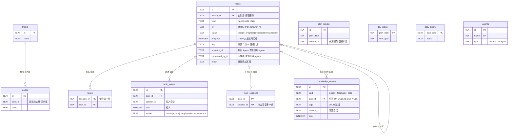

# DSH Task Gantt（任务甘特图）

一个 DeepSeek Harness Web UI 插件：在左侧边栏加入**任务甘特图**与**今日安排**两个页面，由本地 SQLite 数据库和挂载在 harness 既有鉴权通道上的 JSON API 支撑。

除 Node 内建模块与 harness 提供的 React 外零运行时依赖，也不起第二个服务：host 半区是 `src/host/` 下的纯 ESM 模块（按 `routes/`、`store/`、`tree/`、`tracker/`、`daily/` 分目录组织），浏览器半区由 `src/client/` 打包成单个经典脚本产物 `lib/client.js` 交给 DSH 加载。右侧会话栏 tab 可选（依赖 `dsh-better-sidebar`），助手工具可选（依赖 host tools 服务）；插件本身从不调用 LLM。

## 核心功能

### 任务树与时间轴

- **层级任务树**：自动 `1` / `1.1` / `1.1.1` 编号；六条导入支线作为树根，Hermes 节点挂在其下，导入的工作直接可见。支持创建、编辑、拆分、移动、删除，也可以在时间轴网格上**拖动条形来移动或缩放任务**。
- **两种时间刻度**：**周**——28 天，一天一列，月分组表头、周末底纹、今日线，上/下一格移动 14 天；**月**——12 个月，一月一列，年分组表头、按天数比例的列宽，上/下一格移动 3 个月。两种刻度共享同一棵树，切刻度时行不动。
- **状态与父级汇总**：状态与进度标注在行上；有子任务时，日期与进度读时从子级汇总，父级状态遵循 tracker 规则——父自身的状态胜过更弱的子级派生态。
- **深度缩放**：三档折叠——全部节点 / 两层 / 一层。

### 标签行

时间轴上方一行预定义标签 + 手工 `#tags`，多选时路径取并集：

**全部 / 未完成 / 进行中 / 前沿 / 该动 / 今日 / 已完成 / 灵感**

未完成 = 状态非 done/cancelled 的全部任务；进行中 = 工作会话在跑或待选择的任务；前沿、该动 = 各支线的前沿与 next 路径；今日 = 每日简报当天选中的任务；灵感 = `inspiration` 字段非空的任务池（跨支线）。行右侧**重算前沿和该动**按钮重算每日简报。

### 工作模式与工作台

点一行直接进入工作台交互，不离开页面：**工作台**面板在树旁展开，含该任务的工作会话、定高可滚动的 markdown 描述预览与轨迹。还没有会话的任务显示**执行**——在工作区创建专用会话、排队本地化**完成任务** prompt 让模型立即开工，并在新窗口打开该会话（一任务一会话，之后复用）；**拆解**同流程排队**拆解任务** prompt。等待中的任务带警示徽标。工作台同时注册为原生右侧栏的一个 tab。

### 今日安排

当天的计划时间块按格分组、一键改状态；显示参与当天的树节点与当天核心目标；完整性警告共四种——落点缺失、晚格缺失、灵感编号缺失、当天未计划。排期产生的块标明来源任务，**今日该动**区块列出简报窗口并支持手动重算。

### 灵感捕捉

工具栏一句话捕捉未定型灵感进任务树：不写完成标准、不排期（日期占位），灵感原话存进 `inspiration` 字段；标签行的**灵感**标签汇聚跨支线任务池，未定型行有可见标记，之后由人挑时间定型。对应的助手工具是 `gantt_capture`。

### 会话助手协议

原生会话右侧栏的**甘特** tab 让每个会话聚焦一个任务；助手工具让该会话读聚焦链路、把拆解直接写进树。每次工具写入自动记录 DSH 会话与轮次到任务轨迹，tab、工具与 `GET /api/gantt/trajectory` 都能读回。工作模式下每轮必须以 `gantt_track` / `gantt_update_task` / `gantt_decompose` / `gantt_create_task` 之一收尾，保证轨迹与实际工作不脱节。

### 注册面

| 界面 | 插槽 | 注册 |
| --- | --- | --- |
| 左侧边栏图标 | `sidebar.panellist` | id `gantt` |
| 中央页面 | `main` | key `gantt` |
| 左侧边栏图标 | `sidebar.panellist` | id `today` |
| 中央页面 | `main` | key `today` |
| 会话侧栏 tab | `dsh-better-sidebar` | `registerTab` id `gantt`，`single: true` |
| 工作台 tab | `dsh-better-sidebar` | `registerTab` id `gantt-work`，`single: true` |

点侧栏图标即像内置 Plugins / Schedules 页一样选中对应的 `main` 页面。

## 安装

要求 DeepSeek Harness（最后验证线与支持集见 [docs/compatibility.md](docs/compatibility.md)；Node 版本随 DSH 要求，当前 `>=24.9.0`）。

安装一个 checkout 的绝对路径。GUI 插件管理器：

```text
plugin_manager install_bundle { target: "/absolute/path/to/dsh-gantt" }
```

或 CLI：

```sh
dsh plugin --profile web add /absolute/path/to/dsh-gantt
```

或从 checkout 内（安装方式相同，并顺带验证 profile 组合仍然成立）：

```sh
pnpm run deploy                 # 链接本 checkout 并验证 profile
pnpm run deploy --check         # 只验证已有链接，不改动依赖
pnpm run deploy --uninstall     # 从 profile 移除 bundle
```

每种方式都记录一条 pnpm `link:` 依赖，profile 解析到本目录而非拷贝：改了 `src/host/` 后重启 `dsh web`；改了 `src/client/` 后跑 `pnpm run build`（打包输出有变化时重写 `lib/client.js`）并刷新页面——无需重装。已部署的 profile 相反：它把发布 tarball 固定为 `file:` 依赖，checkout 改动在那里不生效。两种形态的切换、对着 pin 住的 profile 迭代的回链与重打包循环见 [docs/deployment.md](docs/deployment.md#34-switching-a-profile-from-link-to-file) 与 [docs/development.md](docs/development.md#iterating-against-a-pinned-deployment)。目标不是默认 `web` profile 时，`pnpm run deploy` 接受 `--profile <name>` 与 `--home <dir>`。

之后打开 Harness 页面：bundle 激活后侧栏条目立即可见、重启后仍在。私有包，永远按路径安装，不发布到 npm。

## 快速开始

1. 侧栏打开**任务甘特图**。
2. 空库时点**载入演示数据**：得到两项目 13 任务的小树，体验时间轴、状态循环与父级汇总。
3. 用**新建任务**、行内操作与**拆分**搭自己的树；**周 / 月**、箭头与**今天**移动时间轴；深度缩放把树折叠成全部节点 / 两层 / 一层。
4. **API** 按钮显示解析出的数据库路径与完整端点目录，可直接抄进 `curl`。
5. 侧栏打开**今日安排**，按**导入计划**把个人任务 tracker 导入数据库；导入的支线与节点即成为甘特树；`‹` / `›` 翻日。
6. 树行上**拆解**创建子任务（可顺带给每个子任务排期），**排期**把已有节点放进某天计划，**导出上下文**把整树加当日计划复制成 markdown。
7. 标签行（全部 / 未完成 / 进行中 / 前沿 / 该动 / 今日 / 已完成 / 灵感，加手工 tags）裁剪并集出要看的路径；右侧**重算前沿和该动**刷新每日简报。
8. 装了 `dsh-better-sidebar` 的，在原生会话开**甘特** tab，点任务聚焦它；让会话模型拆解：助手工具读聚焦链路（`gantt_context`）、把子任务（`gantt_decompose`）或更新（`gantt_update_task`）直接写进树。完整 `/gantt` 页内没有 AI 面板。

### 甘特长城 preset 简述

安装本 bundle 同时会声明第二个 agent preset——**甘特长城**（`gantt-long-run`），用于轻量派单会话：persona 自足完整（派单协议本身就是整个系统提示词，host 任务协议不绑定这些会话）；每轮把落点判定收口成三种之一——用户点名的挂现有任务、落点下新建子任务、闲聊直接回答；定位前先 `gantt_knowledge_query` 查同类请求的历史判定，判定后 `gantt_knowledge_save` 沉淀经验；执行交给能力匹配的注册远程 Agent（`gantt_delegate`，SSH 派发自包含简报、不等结果）或本地标准模式 subagent（`gantt_execute`）。知识对与派发对只在该 preset 可见；分发者操作手册以 bundled skill 随插件包分发（`skills/gantt-dispatch-flow/SKILL.md`），同样只挂在该 preset 层。详见下文「甘特长城 preset」节与 [docs/long-run-persona.md](docs/long-run-persona.md)。

## 数据源

host 半区经 Node 内建 `node:sqlite` 打开一个 SQLite 数据库：

```text
$DSH_HOME/gantt/tasks.db
```

`DSH_HOME` 默认 `~/.dsh`。启动 DSH 前可覆盖：

```sh
DSH_GANTT_DB=/absolute/path/to/tasks.db DSH_GANTT_TZ=Asia/Shanghai dsh web
```

`DSH_GANTT_TZ` 设定任务日时区，用于「今天」、计划日期与 08:00 简报重算，默认 `Asia/Shanghai`（本部署的 host 进程跑在 UTC）；非法 IANA 时区回退默认值。

### Schema 版本与表角色

Schema 首次激活时创建、打开时原地升级，当前版本 **10**：v9 给 `tasks` 加 `tags` 标签列，v10 加 `knowledge_entries` 知识表；更早的库（v1–v9）在打开时逐步迁上来（迁移与一次性回填见 [docs/compatibility.md](docs/compatibility.md)）。日期是任务日时区的 `YYYY-MM-DD`；任务状态 ∈ `todo` / `in_progress` / `blocked` / `done` / `cancelled`；计划块状态 ∈ `todo` / `in_progress` / `done` / `skipped`。

`tasks` 是唯一工作树：`kind='track'` 的六条导入支线做根、`kind='node'` 的导入 Hermes 节点、`kind='task'` 的手工与拆解任务。每行带 tracker 的 `ref` / `state` / `lane` / `dep` / `done_when` / `landing` / `estimate` / `category` / `inspiration`，插件的 `links` / `tags`，以及外部执行写回列 `operator_id` / `completed_by_id` / `report`；导入行 `(kind, ref)` 唯一，重导即 upsert，撞键 409。

| 表 | 角色 |
| --- | --- |
| `tasks` | 唯一工作树：支线根、导入节点、手工与拆解任务 |
| `tracks` / `nodes` | 导入快照：保留 markdown 原文、做幂等键，不渲染成树 |
| `plan_blocks` | 时间格：导入块 + 排期产生的块 |
| `day_plans` | 每个计划日一行：周几、日型、开市标记、核心目标 |
| `daily_briefs` | 每日该动报告的持久快照，一天一份 |
| `focus` | 每个会话聚焦的任务 |
| `task_events` | 只追加的任务轨迹：动作、DSH 会话、轮次、明细、时间 |
| `work_sessions` | 任务 ⇄ 内容专用主会话 的映射：会话 id 唯一 |
| `agents` | 外部操作者注册表（human / ai-agent） |
| `knowledge_entries` | 长跑派单层的判定与经验：kind、标题、正文、可选任务关联、标签、溯源 |

导入器先写快照层，再在同一个 `BEGIN IMMEDIATE` 事务里物化进 `tasks`，两层保持同步。导入是显式、幂等的拉取——默认读 `/data/home/clawd/projects/task-tracker`（`DSH_GANTT_TRACKER_DIR` 覆盖）的 markdown 工作区（`SCHEDULE.md`、`TREE.md`、`daily/*.md`），无 watcher、不回写。领域模型与完整性检查见 [docs/personal-task-system.md](docs/personal-task-system.md)。

### ER 关系图



三种删除语义是这张图的核心设计：

- **级联删除**：任务删了，`focus` / `task_events` / `work_sessions` 跟着删。
- **只解绑不删行**：`knowledge_entries.task_id` 是 `ON DELETE SET NULL`——任务没了，教训留下。
- **无外键的逻辑引用**（靠 store 层校验）：`tasks.dep` → 前置节点；`tasks.operator_id` / `completed_by_id` → `agents`；`nodes.track_id` → `tracks`；`plan_blocks.source_ref` → 来源任务。

### 汇总规则与已知限制

层级编号、统计、前沿/next、上下文 markdown 都是**读时派生**，从不落库。父级 rollup 是缓存：父自身的 tracker 状态决定未完成时读「进行」还是「卡住」；已知限制——失去最后一个子任务的父级保留最后一次汇总值（见 [docs/compatibility.md](docs/compatibility.md)）。父级字段不从 UI 直接编辑。

### 简报快照

`daily_briefs` 是确定性的持久快照，不是活状态：host 在任务日时区 08:00 重算、**重算**按钮触发、或当天无存储报告的首次读取触发。

### 并发

WAL 模式，`tasks.db-wal` / `tasks.db-shm` 在库文件旁边。一个 DSH 进程对应一个数据库文件；不要让多个 DSH 进程同时指向同一个文件（见 [docs/compatibility.md](docs/compatibility.md)）。

## 模型工具

插件注册给模型的全部工具分三组。

### 每会话六件套（host 注册）

host 插件在 tools 服务上为**每个会话**注册六个助手工具；写入走 store 校验，自动记录会话与轮次溯源：

| 工具 | 说明 |
| --- | --- |
| `gantt_context` | 读任务树与本会话聚焦的任务：到支线根的链路、完成标准、直接子任务、最近轨迹；未聚焦时回整棵树。树未变只回一行提示。拆解或回答任务问题前先调用 |
| `gantt_create_task` | 在聚焦任务之后创建同级节点；建议带可验证的完成标准 `doneWhen` |
| `gantt_decompose` | 把聚焦任务拆成子任务写进树；每个子任务必须带可验证 `doneWhen`；最多 4 层、单次最多 100 个 |
| `gantt_update_task` | 更新状态 / 进度 / 标题 / 描述 / 完成标准；标 `done` 自动记录完成的会话与轮次 |
| `gantt_track` | 本轮没有任务树写入时的收尾轨迹关联：`summary` 写清本轮做了什么 |
| `gantt_capture` | 未定型灵感捕捉：在支线或任务下建子任务，不写完成标准、不排期，灵感原话进 `inspiration` 字段，之后由人定型；与 `gantt_create_task` 的分工是「先落账后定型」vs「已定型」 |

### 知识库工具对（gantt-long-run preset 专属）

只在该 preset 的 tools 层注册，普通会话看不到。知识存进同一 SQLite 库的 `knowledge_entries` 表、按落点任务关联——任务删除只解绑不删行，教训比任务活得久：

| 工具 | 说明 |
| --- | --- |
| `gantt_knowledge_save` | 写一条任务判定知识：为什么落这个任务、对判定的评价反馈、可复用的经验教训。`title` + `content` 必填；`kind` 默认 `lesson`（`lesson` / `feedback` / `note`）；`taskId` 接受内部 id、点号 id 或编号（如 `1.8.1`）；传 `id` 整体替换已有条目；自动记录写入会话与轮次 |
| `gantt_knowledge_query` | 查过往判定与经验：`query` 关键词（匹配标题与正文）、`taskId` 关联任务、`kind` 类型、`tag` 标签、`limit`（默认 8、上限 50），最新在前；返回 markdown——每条含 id、关联任务、日期、标签与 240 字符内容摘要。定位任务前先查一次同类请求的历史判定，避免重复踩坑 |

知识只进库表、不留在对话里——派单会话长期跑而上下文不膨胀，靠的就是这条。

### 派发工具对（gantt-long-run preset 专属）

| 工具 | 说明 |
| --- | --- |
| `gantt_agents` | 列出 MCP 注册的外部 Agent 及其能力、可远程派发的 endpoint 方案与 dispatch 命令；委派前先看它定归属与接单人 |
| `gantt_delegate` | 把甘特任务委派给注册远程 Agent：按 endpoint 方案选投递通道（当前为 SSH——以它登记的无头命令在远端启动它），自包含简报（点号编号、标题、完成标准、执行说明、补充要求）发出。`goal=execute` 执行并自上报，`goal=decompose` 只拆解（领域知识在远端时用这个）；操作人记为该 Agent；派发不等结果，远端完成后经 MCP 写回任务树 |

执行兜底 `gantt_execute`：由 DSH 内置 `@deepseek-ai/dsh-tool-subagent` 提供的委派工具（`cordis.patch.yml` 配置 `toolName: gantt_execute`、`agentPreset: standard`，无模型可见覆盖）——没有能力匹配的远程 Agent 时，执行落在带全量工具集与任务协议的标准模式 subagent 上。

### MCP 工具（外部 Agent）

`gantt-mcp` 服务器给外部编码工具暴露十个工具——`register_agent` / `list_agents` / `list_ready_tasks` / `get_task_context` / `create_task` / `decompose_task` / `update_task` / `track_task` / `report_completion` / `get_worker_guide`——参数与返回 schema 见 [docs/mcp.md](docs/mcp.md)。

## JSON API

28 条路由全部挂在 harness 已有的鉴权 `/api` 通道上；浏览器带正常会话 cookie，无第二端口、无 token、无 CORS 设置。错误体 `{ "ok": false, "error": "..." }` 配 `4xx` / `5xx`。

| Method | Route | 用途 |
| --- | --- | --- |
| `GET` | `/api/gantt/tree` | 统一树：编号、汇总、统计、前沿/next `brief`、当日 `dailyBrief`；`?tags=&mode=` 手工标签过滤 |
| `GET` | `/api/gantt/agents` | 注册的外部操作者（`?type=&role=&q=&limit=`） |
| `POST` | `/api/gantt/agents` | 注册或更新外部操作者 |
| `GET` | `/api/gantt/task/context` | 单任务的稳定 markdown 上下文（`?taskId=`） |
| `GET` | `/api/gantt/ready` | 就绪 / next / todo 工作（`?tag=&tags=&mode=&limit=`） |
| `POST` | `/api/gantt/task/report` | 外部完成报告写回（`{taskId, agentId, report, ...}`） |
| `GET` | `/api/gantt/focus` | 会话聚焦的任务（`?sessionId=`） |
| `POST` | `/api/gantt/focus/set` | 给会话聚焦一个任务，或清除 |
| `GET` | `/api/gantt/trajectory` | 最新在前的任务轨迹事件（`?taskId=&sessionId=&limit=`） |
| `GET` | `/api/gantt/work` | 工作目录、聚焦/请求的任务与其专用会话（`?taskId=&sessionId=`） |
| `POST` | `/api/gantt/work/session` | 绑定任务的专用会话并聚焦（`{taskId, sessionId}`） |
| `GET` | `/api/gantt/work/skills` | 工作台 tab 的可选 host 技能目录 |
| `GET` | `/api/gantt/work/team` | 专用会话的 subagents（`?sessionId=`） |
| `GET` | `/api/gantt/meta` | 数据库路径、状态、kind、链接类型、端点目录 |
| `POST` | `/api/gantt/tasks` | 创建任务（含 tracker 元数据字段） |
| `POST` | `/api/gantt/task/update` | 更新任意可写任务字段 |
| `POST` | `/api/gantt/task/status` | 只改状态 / 进度 |
| `POST` | `/api/gantt/task/split` | 创建子任务 |
| `POST` | `/api/gantt/task/decompose` | 拆解节点并可选给每个子任务排期 |
| `POST` | `/api/gantt/task/schedule` | 把已有节点放进某天计划（幂等） |
| `POST` | `/api/gantt/task/delete` | 删除任务及其后代 |
| `GET` | `/api/gantt/context` | 导出整树与某日计划为 markdown 模型上下文 |
| `POST` | `/api/gantt/seed` | 空库时插入演示任务 |
| `GET` | `/api/gantt/day` | 某日计划包：块、树节点、完整性、统计、`brief` |
| `POST` | `/api/gantt/plan/status` | 设计划块状态与可选备注 |
| `POST` | `/api/gantt/plan/import` | 把任务 tracker markdown 导入统一树 |
| `GET` | `/api/gantt/brief` | 某日该动报告，有存储即缓存 |
| `POST` | `/api/gantt/brief/compute` | 重算并持久化当日报告 |

终端 `curl` 需要页面的会话 cookie：打开 `dsh web` 打印的带 token URL 一次，再从浏览器 DevTools 的已鉴权请求里抄 `Cookie` 请求头。把 cookie 当凭据对待。

插件本身不调 LLM：原生会话模型经上面的助手工具读写任务。完整请求/响应示例、字段表、focus、工具参数与错误码见 [docs/api.md](docs/api.md)。

## MCP 服务器

包内附带零依赖 [Model Context Protocol](docs/mcp.md) 服务器（默认 stdio，可选鉴权 HTTP），供外部编码工具使用：`gantt-mcp` 对同一 SQLite 存储暴露 Agent 注册、就绪任务列表、单任务上下文与完成写回。

## 甘特长城 preset

安装本 bundle 同时声明第二个 agent preset——**甘特长城**（`gantt-long-run`），用于轻量派单会话。它的 persona 是完整的：派单协议本身就是整个系统提示词，host 任务协议不绑定这些会话。每轮把落点判定收口成三种之一（用户点名的挂现有任务、落点下新建子任务、或直接回答），可选 web 搜索补判定素材，经 `gantt_knowledge_save` 存判定的评价与教训，然后把执行交给能做的人：

- **远程 Agent**：`gantt_agents` 列出 MCP 注册的操作者及各自能力；`gantt_delegate` 认领任务的操作者，把简报经其登记的 `dispatch:` 命令走 SSH 转发——与 `scripts/remote-exec.mjs` 同一守卫与审计日志——拿到启动 ack 即返回，远端 worker 自己经 gantt MCP 面上报结果。
- **本地兜底**：`gantt_execute` 委派工具派给标准模式 subagent（`agentPreset: standard`，无模型可见覆盖），执行落在带全量工具集与任务协议的 subagent 上。

领域知识在远端时，也可让远程 Agent 只拆解（`goal=decompose`）。派发简报——用户原话、30 字内路由注记、相关链接——存进子任务的 `description`，工作台按 markdown 渲染；prompt 引用它，因为无论 spawned executor 还是远端 worker 都读不到任务树。知识对与派发对只在本 preset 可见；每条知识存同一 SQLite 库（`knowledge_entries`），关联落点任务，任务没了也只解绑、永不删行。分发者每轮操作手册以技能形式随包分发（`skills/gantt-dispatch-flow/SKILL.md`，`src/host/dispatch-skill.js` 注册为 bundled skill）：只在甘特长城会话的技能目录出现，标准会话与其他 preset 一律不列出；安装插件即得、无需每台机拷贝，用户或项目里的同名技能优先于包内版。派单者原样转达收尾报告、对 executor 交回的东西重新定位。persona 镜像在 [docs/long-run-persona.md](docs/long-run-persona.md) 供阅读，`tests/host/preset.spec.js` 逐字节 pin 住。

## 验证与质量门禁

| 命令 | 管什么 |
| --- | --- |
| `pnpm run verify` | 每个源码、测试、脚本文件的语法检查 |
| `pnpm run build` | 把 `src/client/` 打包成 `lib/client.js`（rolldown） |
| `pnpm run lint` | oxlint |
| `pnpm run typecheck` | host / client / tests 全量 TypeScript `checkJs` |
| `pnpm run static` | lint + typecheck（pre-commit 钩子跑的，~3s） |
| `pnpm run test` | vitest host + jsdom client 单测 |
| `pnpm run coverage` | 单测加每文件覆盖率阈值 |
| `pnpm run e2e` | 重建客户端产物，对真实 HTTP + 真实 SQLite 跑行为测试 |
| `pnpm run check` | 完整门禁（pre-push 钩子跑的）：static + coverage + e2e 并行，带缓存 stamp |

覆盖率：`src/host/**` 与 `src/shared/**` 每文件 100%，`src/client/**` 每文件 99/98/99/99（阈值只升不降，放宽需在 `docs/development.md` 记决策）；四个 host 门面是纯 re-export，报告打印 `0/0`，阈值照过。提交只跑 static；`.husky/pre-push` 在推到 `main` 前跑完整门禁，绿树才放行（绿结果在 `.tmp/check.stamp` 缓存 60 分钟，stamp 不匹配待推树即拒推）。无 PR 流程；CI 只在 `v*` 发布 tag 上重跑同一门禁（`.github/workflows/release.yml`）。`pnpm run deploy` 把 checkout 链接进 DSH profile 并验证组合树（见[安装](#安装)）。

手工核查补充：

- `cordis_inspect_query` 查 Client `Slots.listSubTree`（`root: "sidebar.panellist"` 与 `root: "main"`）能看到活的 `gantt` / `today` 注册。
- 页面在连接的 Web GUI 里渲染。视觉验证需要浏览器页面；slot 注册与 bundle 激活本身不能证明渲染结果。
- 一次性 profile 验收 pass 与手工 GUI 清单在 [docs/development.md](docs/development.md#verification-procedure)。

## 布局、主题与安全

- 页面作为 React 组件渲染进 `main` 插槽；不套 iframe、不往 `document.body` 追加第二个应用。
- 面板是外壳的中列，宽度跟随侧栏折叠与拖动；布局用容器查询（含窄宽下的右栏会话 tab）折叠，不用视口断点。
- 样式走 `--dsw-alias-*` 主题 token，明暗主题与 host 主题变化自动继承。
- 可见文案全部经 Client locale 服务注册 en + zh 双语。
- 右侧 tab 可选：客户端注入 `betterSidebar` 服务注册每会话 tab；没有该插件时 tab 不在、完整页面照常工作。助手工具注册在可选的 host `tools` 服务上、写入走 store 正常校验；插件本身不调模型。
- API 由既有 `/api` 会话 cookie 鉴权；不开独立监听。
- 数据库属于本 DSH home。多个 DSH 进程共享同一 `$DSH_HOME` 时，不要同时指向同一个 SQLite 文件。

## 源码结构

代码在 `src/` 下，一事一文件，所有源文件 < 1000 行。

| 路径 | 角色 |
| --- | --- |
| `src/host/index.js` | 插件入口：store 生命周期、08:00 调度器、路由 / 助手工具 / prompt 注册 |
| `src/host/prompt.js` | 任务协议节（四工具收尾要求）与会话聚焦上下文注入 |
| `src/host/routes/` | 28 条 `/api/gantt/*` 路由 spec 按资源分文件（含 `focus.js`、轨迹读取、`work.js`、`agents.js`）；`http.js` 共享管道 |
| `src/host/store/` | SQLite schema 与迁移（`db.js`）、任务/树写入、轨迹 `task_events`、Agent 注册表、任务⇄工作会话映射、知识表（`knowledge.js`）、08:00 调度器（`scheduler.js`）、简报持久化、上下文文档 |
| `src/host/store.js` / `tree.js` / `tracker.js` / `daily.js` | 四个纯 re-export 门面，为测试保持公共面稳定 |
| `src/host/errors.js` | `GanttError`：带 HTTP 状态码的错误类型 |
| `src/host/work.js` | 专用会话的工作目录（`DSH_GANTT_WORK_CWD`） |
| `src/host/tracker/` | tracker markdown 解析器与导入器 |
| `src/host/tree/` | 纯树助手：编号、汇总、前沿/next、物化、上下文 markdown、`chain.js` 聚焦渲染 |
| `src/host/clock.js` | 任务日日期与下一个 08:00（`DSH_GANTT_TZ`，默认 `Asia/Shanghai`） |
| `src/host/session-titles.js` | 轨迹行的会话标题解析 |
| `src/host/daily/` | 每日该动报告：窗口、角色预算、公平性、报告渲染 |
| `src/host/tools.js` | 六件套助手工具、任务引用解析（内部 id / 点号 id / 编号）、自动溯源记录 |
| `src/host/knowledge.js` | preset 专属知识对（`gantt_knowledge_save` / `gantt_knowledge_query`） |
| `src/host/dispatch.js` | preset 专属派发对（`gantt_agents` / `gantt_delegate`）：endpoint 方案 transport 表（当前 SSH；daemon 直连在规划）、注册列表、自包含简报 |
| `src/host/dispatch-ssh.js` | SSH 派发 transport：解析 Agent 的 `ssh://` endpoint 与 `dispatch:` 命令，守卫下转发一条简报 |
| `src/host/dispatch-skill.js` | preset 专属分发手册技能：把包内 `skills/gantt-dispatch-flow/SKILL.md` 注册为 bundled skill（安装即分发，同名用户/项目副本优先） |
| `src/host/remote.js` / `remote-guard.js` | 共享 SSH 转发机制与破坏性命令安全门，`dispatch.js` 与手工 `scripts/remote-exec.mjs` CLI 同用 |
| `src/host/long-run.js` | 甘特长城 preset 的插件入口（`cordis.patch.yml` 行挂载） |
| `src/host/mcp.js` + `bin/gantt-mcp.js` | 外部 Agent JSON-RPC 服务器与其 CLI（stdio 或可选 HTTP） |
| `src/client/` | 浏览器 ESM：插件入口、页面（`gantt` / `today` / 右栏 `panel` / 工作台 `workbench`）、工作模式导航（`work-nav`）、标签行（`label-filter`）、拖条（`bar-drag`）、markdown 渲染（`markdown.js`，全 UI 唯一入口）、对话框（`dialogs/` 含灵感捕捉 `capture`）、会话活动（`session-status`）、新窗交接（`session-window`）、激活页恢复（`panel-session`）、页面状态恢复（`page-state`）、`i18n/`、styles |
| `src/shared/vocabulary.js` | 双半区共用的状态词表 |
| `lib/client.js` | 打包产物（gitignored） |

`scripts/build-client.mjs` 用 rolldown 把 `src/client/index.js` 打包成 `lib/client.js`。产物必须保持单个经典脚本：DSH 只从 `exports["./client"]` 元数据（mtime/ctime/size）派生 revision、把所有 chunk URL 当不可变资源服务，拆入口成多个运行时 chunk 会让 revision 不变而浏览器停在旧字节上。React 保持 external——DSH loader 往工厂注入 `require`，平台 React 实例经 `require('react')` 到达，产物没有顶层 `import`/`export`。字节没变的打包保持产物不动，空跑门禁不会改 revision（那会刷新所有打开的页面）。e2e 套件重建产物并 pin 住这两条规则；`pnpm run build` 也在 `prepare` 钩子里跑。

## 文档索引

- [docs/README.md](docs/README.md) — 文档索引
- [docs/development.md](docs/development.md) — 环境搭建、工具链、门禁、验证
- [docs/api.md](docs/api.md) — JSON API 参考
- [docs/mcp.md](docs/mcp.md) — MCP 服务器、传输、十个工具、排障
- [docs/worker-flow.md](docs/worker-flow.md) — 外部 worker 如何经 MCP 拉上下文、拆解、收尾
- [docs/deployment.md](docs/deployment.md) — 插件与 MCP sidecar 的 k3s 同 Pod 部署、升级/回滚、schema 契约、Claude Code / Codex 客户端
- [docs/remote-exec.md](docs/remote-exec.md) — 守卫式 SSH 包装：规则、审计日志、测试
- [docs/compatibility.md](docs/compatibility.md) — 支持集、harness 接缝、限制
- [docs/personal-task-system.md](docs/personal-task-system.md) — 统一任务树模型、拆解纪律、前沿/next、每日该动、助手工具、轨迹与协议上下文
- [docs/work-context.md](docs/work-context.md) — 工作模式会话看到的上下文
- [docs/model-context.md](docs/model-context.md) — 组合后的模型上下文全景
- [docs/long-run-persona.md](docs/long-run-persona.md) — 甘特长城 persona 镜像
- [CONTRIBUTING.md](CONTRIBUTING.md) — 工作流、提交、发布清单
- [AGENTS.md](AGENTS.md) — 工程政策（优先级、测试、文件大小、门禁）

## 许可

私有、`UNLICENSED`；不发布到 npm。
